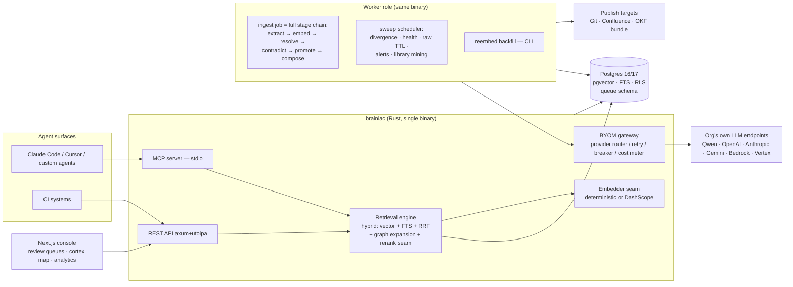

# Brainiac — Architecture

> **Source of truth (code this doc describes).** Every claim below should be
> checkable against these paths; if they change, this doc is stale.
>
> - `crates/brainiac-core/**` — pure domain math (embed, fusion, rerank, scoring, temporal, health, redact, library, types)
> - `crates/brainiac-store/**` — the Postgres data plane (RLS, retrieval, governance, documents, library, queue, tokens, projects)
> - `crates/brainiac-gateway/**` — BYOM chat/embed providers + resilience + LLM telemetry
> - `crates/brainiac-pipeline/**` — the worker stage chain and the sweeps
> - `crates/brainiac-server/**` — axum HTTP, MCP, sweep scheduler, onboarding, the `clap` CLI
> - `crates/brainiac-publish/**` — outward publishing targets (Git, Confluence, OKF)
> - `migrations/**` — the schema, append-only and numbered
>
> Related docs: `docs/PLAN.md` (build ladder + recorded deviations),
> `docs/EVAL.md` (quality measurement), `docs/KB-PLAN.md` /
> `docs/KNOWLEDGE-BASE.md` (§8), `docs/LIBRARY-PLAN.md` (§10),
> `docs/PROJECT-PLAN.md` (§11).

**Positioning:** GitOps for organizational AI knowledge. Capture knowhow from real LLM sessions → provenance → review/promotion pipeline → versioned, permission-aware distribution to agents.

**Status convention used throughout this document.** Unmarked prose describes
code that exists in this repository today. Anything not yet built is marked
**[not shipped]** with the intent preserved, because the intent is still the
plan — it is simply not a description of the running system.

**Stack, as built:**

| Layer | Choice |
|---|---|
| Core service & workers | Rust (axum 0.8, one binary `brainiac`, roles are subcommands) |
| Data plane | Postgres 16/17 only — pgvector (HNSW), FTS, RLS, and the job queue |
| Queue | `queue.jobs` / `queue.archive`: a `SKIP LOCKED` queue in plain SQL with pgmq-shaped semantics (`migrations/0001_init.sql`, `crates/brainiac-store/src/queue.rs`). **pgmq the extension is not used** — see PLAN.md deviation 1. Kafka **[not shipped]**, deferred until corporate scale proves it |
| Deployment | Self-hosted: `docker-compose.yml` (Postgres for dev) and `docker-compose.deploy.yml` (pg + server(+worker) + console). Helm chart **[not shipped]** |
| LLM engine | BYOM gateway, one `ChatProvider` trait: Qwen/DashScope (default), OpenAI, Azure OpenAI, any OpenAI-compatible base URL (Groq/Together/DeepSeek/Mistral/OpenRouter/Ollama/vLLM), Anthropic, Google Gemini, AWS Bedrock, Google Vertex, plus a deterministic `MockProvider` |
| Embeddings | `brainiac_core::embed::Embedder` seam. Shipped implementations: a deterministic hashed bag-of-tokens embedder (default, model-free) and `QwenEmbedder` (DashScope). In-process ONNX/Candle or a TEI sidecar **[not shipped]** |
| Reranking | `brainiac_core::rerank::Reranker` seam; `LexicalOverlapReranker` ships as the model-free proof. Cross-encoder ONNX model **[not shipped]** |
| UI | Next.js 15 / React 19 / Tailwind 4 console (`console/`), one SPA under `/console/(modules)`; charts via Recharts, graph via a custom SVG "Cortex Map". Sigma.js/WebGL **[not shipped]** |
| Agent interface | MCP server on stdio (`brainiac mcp`) as a first-class surface, REST/OpenAPI (utoipa → `openapi.json`) alongside |
| Identity | Bearer tokens: env-bootstrap operator tokens + managed `brk_…` API tokens (hashed, scoped, revocable), and a Google-identity free-tier provisioning path (`identities`, migration 0022). OIDC/SAML SSO and SCIM group sync **[not shipped]** — `team_members` is currently seeded/administered directly |
| Blob storage | **None.** Raw transcripts live in `sources.raw_text` in Postgres. S3/MinIO **[not shipped]** (PLAN.md deviation 5) — Postgres stays the only stateful dependency |
| Observability | `tracing` structured logs; Sentry error tracking (`sentry`/`sentry-tracing`, opt-in via DSN); LightTrack fire-and-forget LLM-call telemetry from the gateway (opt-in via `LIGHTTRACK_URL`); an operator alert-webhook sweep; the eval harness as the CI quality gate. OpenTelemetry traces + Prometheus metrics **[not shipped]** |

---

## 1. System overview



One deployable unit: the core binary embeds the MCP server, REST API, retrieval
engine, BYOM gateway and the embedder. Workers are the same binary run as
`brainiac worker`, or folded into the API process with `brainiac serve
--with-worker` (one runtime, one pool — the free-tier-VM path). Postgres is the
**only** mandatory stateful dependency: no object store, no message broker, no
separate cache. Self-hosted footprint is Postgres + one binary (+ the console
container if you want the UI).

CLI roles (`crates/brainiac-server/src/main.rs`): `serve`, `worker`, `mcp`,
`reembed`, `scan-divergence`, `okf-harvest`, `eval`, `fixtures`, `openapi`,
`lint`, `schema`.

---

## 2. Data model (schema core)

Conventions: tenant tables carry `org_id`; RLS policies key off `org_id` +
team visibility; timestamps are `timestamptz`; soft-delete via `deleted_at`.
Types are abbreviated below — `migrations/0001_init.sql` onward is normative,
and migrations are **append-only and numbered** (`sqlx::migrate!`).

### 2.1 Identity & tenancy

```sql
CREATE TABLE orgs        (id uuid PK, name text, settings jsonb);
CREATE TABLE teams       (id uuid PK, org_id uuid FK, name text, idp_group_id text,
                          UNIQUE (org_id, idp_group_id));
CREATE TABLE users       (id uuid PK, org_id uuid FK, idp_subject text, email text);
CREATE TABLE team_members(team_id uuid FK, user_id uuid FK, role text, PRIMARY KEY(team_id, user_id));
-- role: member | maintainer (maintainers approve promotions for their team)
```

`idp_group_id` exists for the SCIM story; **SCIM reconciliation is [not
shipped]** — membership is written by fixture seeding, provisioning, and
operator action today (`crates/brainiac-store/src/orgs.rs`). Maintainership is
already load-bearing: promotion approve/reject and contradiction supersede
require `team_members.role = 'maintainer'` on the owning team
(`crates/brainiac-server/src/console.rs`).

Two identity paths exist alongside the org tables:

- `api_tokens` (migration 0003) — `brk_…` tokens, sha256-hashed, scoped,
  revocable, `last_used_at`-tracked, optionally project-scoped.
- `identities` (migration 0022) — a verified Google identity ↔ the ONE org that
  identity owns. Deliberately the only path that creates an org outside fixture
  seeding, and it runs on the RLS-bypassing owner pool because a person signing
  up has no org to scope to (`crates/brainiac-store/src/identities.rs`).

### 2.2 Sources & provenance

```sql
CREATE TABLE sources (
  id uuid PK, org_id uuid, team_id uuid,
  kind text,               -- session_transcript | repo | doc | manual | okf
  external_ref text,
  raw_text text,           -- the transcript itself, IN POSTGRES (no blob store)
  content_hash bytea,      -- integrity / dedup / idempotent replay (migration 0013)
  project_id uuid,         -- migration 0035
  created_by uuid, created_at timestamptz
);

CREATE TABLE provenance (
  id uuid PK, org_id uuid,
  actor_kind text,         -- human | agent | pipeline
  actor_id text,
  model_ref text,          -- e.g. "qwen:qwen-max" when LLM-produced
  source_id uuid FK,
  pipeline_run_id uuid,
  created_at timestamptz
);
```

Every memory, entity, and edge points at a `provenance` row. This is the
attestation layer: any fact in the graph traces to *who/what produced it, from
which session, with which model*. `content_hash` makes ingestion idempotent —
a retried `memory_add` for the same content resolves to the original source and
its original queue job id rather than duplicating work
(`brainiac_store::queue::job_id_for_source`).

### 2.3 Memories (the knowledge units)

```sql
CREATE TYPE memory_status AS ENUM ('raw','candidate','canonical','deprecated','rejected');
CREATE TYPE visibility    AS ENUM ('private','team','org');

CREATE TABLE memories (
  id uuid PK, org_id uuid, team_id uuid,
  owner_user_id uuid,                 -- for the private tier
  visibility visibility DEFAULT 'private',
  status memory_status DEFAULT 'raw',
  kind text,                          -- fact | decision | pattern | pitfall | howto
  content text NOT NULL,              -- distilled natural-language statement
  language text DEFAULT 'en',         -- migration 0007: FTS config follows the language
  content_fts tsvector GENERATED …,   -- language-aware (0007), GIN-indexed
  lifecycle text DEFAULT 'shipped',   -- shipped | in_flight | proposed (migration 0015)
  detail_md text,                     -- migration 0015 (see below)
  title text,                         -- migration 0023
  project_id uuid,                    -- migration 0035
  valid_from timestamptz, valid_to timestamptz,   -- temporal validity window
  superseded_by uuid,                 -- forward pointer on deprecation
  confidence real,
  provenance_id uuid FK,
  created_at, updated_at, deleted_at timestamptz
);

CREATE TABLE memory_embeddings (
  memory_id uuid FK, embedding_version_id int FK,
  embedding vector,                   -- typmod-free: dims coexist during a swap
  PRIMARY KEY (memory_id, embedding_version_id)
);

CREATE TABLE embedding_versions (id serial PK, model_name text, dim int, is_active bool, created_at timestamptz);
```

Design points:

- **Embeddings live in a side table keyed by version.** Model swap = insert a
  new `embedding_versions` row, run `brainiac reembed` to backfill, flip
  `is_active`, drop old rows later. Retrieval always filters on the active
  version. No in-place mutation of the corpus. The `embedding` column carries no
  typmod so two dimensionalities coexist mid-migration; dimension-specific HNSW
  indexes are created per version (migrations 0006, 0012).
- **Temporal validity is first-class** (`valid_from`/`valid_to` +
  `superseded_by`), enabling "what did we know in March" queries and preventing
  stale knowhow from poisoning retrieval — deprecated memories are excluded by
  default but preserved for audit (`brainiac_core::temporal`).
- `kind` matters for promotion policy: a `pitfall` can carry different
  auto-promotion rules than a `decision`.
- **`lifecycle` separates shipped reality from intent.** Governance status
  answers *has a human signed this?*; temporal validity answers *when did it
  hold?*. Neither answers what a reader of a generated page asks first: *is this
  how the system works today, or how we plan for it to work?* A decision to
  adopt Kafka can be canonical, currently valid, and describe nothing that
  exists in production. Composed pages split on this facet (§8), so the wiki
  cannot quietly present a roadmap as an architecture. Default `shipped`; the
  extractor departs from it only when the transcript is explicit.
- **`detail_md` preserves structure the sentence destroys.** `content` stays the
  distilled claim and remains the *only* retrieval surface (FTS + embeddings
  point at it); `detail_md` optionally carries the literal code block / config /
  table the claim summarizes. It runs through the same secret-redaction firewall
  as `content` (`brainiac_core::redact` — a credential is likelier to hide in a
  code block than in prose).
- **Redaction is applied at the boundary, not as a report.** Anything lifted out
  of a raw session — stored memory content, `detail_md`, and the verbatim source
  excerpt served by `memory_provenance` — passes through recall-biased pattern
  masking first.

### 2.4 Graph: entities and edges (collision-tolerant)

```sql
-- Raw, team-scoped nodes. IMMUTABLE — never merged or renamed after creation.
CREATE TABLE entities (id uuid PK, org_id uuid, team_id uuid, name text, kind text,
                       aliases text[], provenance_id uuid FK, created_at timestamptz);

-- Org-level canonical entities: the merge targets.
CREATE TABLE canonical_entities (id uuid PK, org_id uuid, name text, kind text,
                                 summary text, created_at timestamptz);
CREATE TABLE canonical_entity_embeddings (…);   -- migration 0008: ANN over merge targets
                                                -- + canonical aliases (0009)

-- Soft merge: reversible, auditable.
CREATE TABLE entity_links (
  entity_id uuid FK, canonical_id uuid FK,
  confidence real,
  method text,                        -- embedding_block | llm_adjudicated | human
  confirmed_by uuid, provenance_id uuid FK,
  PRIMARY KEY (entity_id, canonical_id)
);

CREATE TABLE edges (
  id uuid PK, org_id uuid, src_entity uuid FK, dst_entity uuid FK,
  relation text,                      -- uses | depends_on | owns | deprecates | relates_to
  memory_id uuid FK,                  -- evidence: the memory this edge came from
  provenance_id uuid FK, valid_from timestamptz, valid_to timestamptz
);

CREATE TABLE memory_entities (memory_id uuid FK, entity_id uuid FK, PRIMARY KEY (memory_id, entity_id));
```

Design points:

- **Teams/repos are natural starting points**: each team's ingestion creates
  entities in its own scope. Cross-team collision ("payments API" vs
  "payment-service") is resolved by linking both to one `canonical_entities` row
  — the raw nodes are never destroyed. A wrong merge is `DELETE FROM
  entity_links`, not data surgery.
- **Edges carry evidence** (`memory_id`): every relationship is backed by a
  retrievable statement, so the graph is explainable in the UI.
- Traversal is done with recursive/lateral SQL over the relational tables.
  **Apache AGE is [not shipped]** and is not enabled anywhere; if Cypher
  ergonomics ever earn it, the relational tables stay the source of truth and
  the graph becomes a projection.

### 2.5 Governance: promotions, contradictions, policy

```sql
CREATE TABLE promotions (
  id uuid PK, org_id uuid, memory_id uuid FK,
  from_status memory_status, to_status memory_status,
  policy_decision text,               -- auto_approved | needs_review | denied
  policy_rule text,                   -- which rule fired (audit)
  reviewer_id uuid, reviewed_at timestamptz, created_at timestamptz
);

CREATE TABLE contradictions (
  id uuid PK, org_id uuid, memory_a uuid FK, memory_b uuid FK,
  detected_by text, status text,      -- open | resolved_supersede | resolved_coexist | dismissed
  resolution_note text, resolved_by uuid, resolved_at timestamptz
);

CREATE TABLE memory_feedback (…);     -- migration 0004/0005/0026: useful | stale | wrong + resolution
CREATE TABLE pipeline_runs (…);       -- per-run stats (0001, 0010)
```

**Policy engine:** typed Rust rules behind a Cedar-shaped seam
(`crates/brainiac-pipeline/src/policy.rs`, PLAN.md deviation 2) — **Cedar
itself is [not shipped]**, and policies are code, not per-org editable data.
Every evaluation returns the rule id that fired, which is what lands in the
`promotions` audit row. Shipped rules include:

- Anything → `canonical` **always** requires a human maintainer
  (`canonical_requires_maintainer`).
- A memory that opened a contradiction during its own run is never
  auto-promoted (`contradiction_pending`) — retrieval serves candidates, so
  auto-promoting a conflicting claim would circulate poisoned knowledge before
  a human resolves the queue.
- Kind/confidence/visibility rules govern raw→candidate auto-promotion.

Cross-team maintainer quorum for cross-team canonicals is **[not shipped]**.

### 2.6 Row-level security — the load-bearing part

```sql
ALTER TABLE memories ENABLE ROW LEVEL SECURITY;

CREATE POLICY memories_read ON memories FOR SELECT USING (
  org_id = current_setting('app.org_id')::uuid
  AND ( visibility = 'org'
     OR (visibility = 'team' AND team_id IN
         (SELECT team_id FROM team_members WHERE user_id = current_setting('app.user_id')::uuid))
     OR (visibility = 'private' AND owner_user_id = current_setting('app.user_id')::uuid))
);
```

Connection discipline (`crates/brainiac-store/src/lib.rs`):

- `migrate(url)` runs DDL and role grants as the **connecting admin user**.
- `Store::connect(url)` builds the runtime pool with an `after_connect` hook
  that drops every session to the non-owner `brainiac_app` role — superusers
  bypass RLS, the app role never can.
- `scoped_tx(principal)` opens a transaction with `app.org_id` / `app.user_id`
  `SET LOCAL` from the verified principal. **There is no unscoped query path.**
  Retrieval's parallel candidate queries mirror the caller's scope onto their
  own pooled transactions rather than escaping it.
- One deliberate exception exists: an admin pool that bypasses RLS, used only
  for tenant-blind operator work — the reembed backfill (derived vectors only),
  cross-org sweeps, and org creation at signup (which has no org to scope to).

**Similarity search inherits RLS automatically** — the pgvector scan only sees
permitted rows. Agents can never retrieve what their operator can't. Project
isolation (migration 0040) adds an opt-in fourth axis on top; see §11.

---

## 3. Pipeline stages

**Topology as built:** one `ingest` queue. A claimed job runs the whole stage
chain for its source inside the worker, with the stages kept as separate
functions holding the contracts below — splitting them across queues later is a
worker-loop change, not a redesign (`crates/brainiac-pipeline/src/lib.rs`).

The queue is plain SQL, not an extension (`queue.jobs` / `queue.archive`):
`SKIP LOCKED` claiming with a visibility timeout, `MAX_ATTEMPTS = 5`,
exponential backoff capped at 600s, and two distinct terminal outcomes —
`failed` (the worker ran the job, reported the error, and spent its budget) and
`dead` (crash-poison: the job took the worker down before it could report, and
is reaped at claim time). Both are surfaced by `/v1/queue/dead-letters` and are
requeueable. Claiming is **per-org fair**: ready jobs are ranked with
`ROW_NUMBER() OVER (PARTITION BY payload->>'org_id')`, so one tenant's flood of
100 transcripts cannot head-of-line block everyone else, while FIFO within an
org is preserved.

| # | Stage | Trigger | What it does | LLM? |
|---|---|---|---|---|
| 1 | ingest | MCP `memory_add`, `POST /v1/memories`, `okf-harvest` | Store `sources.raw_text` in Postgres, hash for idempotency, enqueue | no |
| 2 | extract | ingest job | BYOM call: distill facts/decisions/pitfalls/howtos + entity mentions + relations from each chunk; write `memories(status=raw)`, `entities`, `edges`, provenance. Long sources chunk; malformed JSON gets one repair call; near-duplicates dedupe. `temperature = 0.0` on every pipeline call | **yes** |
| 3 | embed | new/updated memory | Embed `content` with the active version → `memory_embeddings` | no (local or DashScope) |
| 4 | resolve | new entity | Embed name+aliases, ANN over `canonical_entity_embeddings`; high-sim pairs go to BYOM adjudication ("same thing?"); confidence ≥ τ auto-links, else human review | **yes** (adjudication only) |
| 5 | contradict | new candidate/canonical memory | ANN + entity-overlap search for close memories with conflicting claims; BYOM verdict; open a `contradictions` row; suggested resolution supersedes (`valid_to`, `superseded_by`) | **yes** |
| 6 | promote | in-chain | Evaluate the policy engine; auto-promote or push to the review queue; write the `promotions` audit row | no |
| 7 | compose | dirty document | Regenerate composed sections of dependent pages (§8) | **yes** |
| 8 | reembed | `brainiac reembed` | Backfill embeddings for a new version, resumable and idempotent, on the operator pool | no |
| 9 | publish | revision published | Hand the current revision to configured targets — Git / Confluence / OKF (§8.5) | no |

**Scheduled sweeps** (`crates/brainiac-server/src/sweeps.rs`, table
`sweep_schedules`, migration 0018) run inside the worker loop: the scheduler
claims due schedules every 20s, advances each row's clock, and spawns the sweep
so a multi-minute LLM scan never blocks ingest. Kinds shipped: `divergence`
(the cross-team standardization sweep, §10), `health_snapshot`, `raw_ttl`
(migration 0024), `alerts` (operator webhook), and `library` (mining). Each is
readable/tunable/runnable from `/v1/ops/sweeps` (admin scope).

**Not shipped:** `scim_sync`, a server-side graph `layout` worker (the console
computes its own layout), and a standalone `export` queue (publishing is driven
from the compose/publish path instead).

**Resilience and cost.** The gateway retries transport errors, 429 and 5xx with
exponential backoff + jitter (defaults 3 attempts / 500ms base / 8s cap) and
opens a per-provider circuit breaker after 5 consecutive ultimate failures
(30s cooldown), so a dead upstream doesn't burn every queued job's retry
budget. Other 4xx fail immediately — a bad key is not a transient. Every
provider call also passes one telemetry chokepoint that reports
`(provider, model, in/out tokens, latency, ok)` to LightTrack when
`LIGHTTRACK_URL` is set; a failed call meters as 0 tokens with `status=error`,
preserving "cost unknown ≠ cost zero". A per-org token-bucket rate budget is
**[not shipped]**.

**Model routing.** `BRAINIAC_PROVIDER` picks the process default (`qwen` when
unset) and `BRAINIAC_MODEL` pins its model; per-stage overrides
`BRAINIAC_MODEL_EXTRACT / _RESOLVE / _CONTRADICT / _COMPOSE / _DIVERGENCE`
accept a `provider[:model]` spec, so extraction and composition can run a
strong model while the short classification calls run a cheap one — across
different vendors if you like.

---

## 4. Retrieval engine (the Rust hot path)

Request flow for `memory_search` / context assembly
(`crates/brainiac-store/src/retrieval.rs` + `brainiac_core::{fusion, scoring,
temporal, rerank}`):

1. **Query understanding** (cheap, local): normalize; exact identifiers survive
   into the lexical arm.
2. **Parallel candidates**, each on its own pooled transaction stamped with the
   caller's RLS scope:
   - pgvector ANN over the active embedding version (HNSW), and
   - Postgres FTS, language-aware per `memories.language`.
3. **Fusion:** reciprocal rank fusion (`score = Σ 1/(k+rank)`, k = 60, stable
   deterministic tiebreak) → the fused pool (30).
4. **Graph expansion:** anchor entities of the top hits → canonical neighbors →
   their strongest memories, bounded (+10). This is where cross-team knowledge
   surfaces: a query about "payments retries" walks through the canonical
   *payments* entity into another team's pitfalls.
5. **Rerank (seam):** the ≤40 assembled survivors can be rescored by a
   `Reranker`. The default is `None`, which is byte-identical to the
   pre-stage-5 path by construction; `--reranker lexical` enables the
   deterministic overlap scorer. The reranker's joint score *replaces* the
   fused relevance term feeding the blend, so recency/feedback nudges still
   apply on top of it.
6. **Assembly:** filter by validity/status/facets/project, dedupe superseded
   chains, blend relevance with recency (day-quantized decay anchored on
   `created_at`) and feedback signal, attach provenance refs and entity anchors,
   truncate to k.

Filters are conjunctive metadata narrowing on top of relevance (kind,
lifecycle, visibility, team, project, as-of instant); `rejected` is always
excluded.

Latency target: p95 < 150 ms without rerank, < 400 ms with rerank on modest
self-hosted hardware. **Not yet measured under load in this repo** — treat it as
a design budget, not a result.

---

## 5. API surfaces

### 5.1 MCP tools (the product interface for agents)

`brainiac mcp` speaks MCP on stdio. Tools shipped
(`crates/brainiac-server/src/mcp.rs`):

| Tool | Purpose |
|---|---|
| `memory_search(query, k, scope?)` | Hybrid retrieval as above; memories + provenance + entity anchors |
| `memory_list` | Browse/filter the corpus (status, kind, project scope) |
| `memory_context(task_hint)` | Session-start bundle: relevant canonical knowledge for the repo/team/task, token-budgeted |
| `memory_add(content, kind, entities?)` | Write a raw memory (enters the pipeline) |
| `memory_status` | Where a submitted memory is in the pipeline/review |
| `entity_lookup(name)` | Resolve name → canonical entity + subgraph summary |
| `knowledge_propose(memory_id)` | Nominate own/team memory for promotion |
| `memory_feedback(memory_id, signal)` | useful / stale / wrong |
| `memory_provenance(memory_id)` | Who/what/when, with a redacted source excerpt |
| `doc_search(query)` / `doc_get(slug, as_of?)` | Page-level retrieval and time-travelled page read (§8) |
| `standards_for` / `skill_search` / `skill_fetch` | The normative layer, agent-side (§10) |
| `standard_propose` / `skill_propose` | Candidate intake from agents |
| `skill_report_usage` | Team-level `fetch/check/apply` telemetry |

MCP identity: each developer's agent authenticates with a personal `brk_…`
token mapped to their user (and optionally their project) → RLS applies
transparently. `memory_context` is the wedge: *one call at session start and the
agent knows what the org knows.*

### 5.2 REST (UI + CI)

OpenAPI is generated from code (utoipa → `openapi.json`) and the console
consumes it through `openapi-typescript`; request/response shapes are never
hand-written on the TS side. Every handler resolves the bearer token to a
principal first — there is no anonymous data path (the one deliberate exception
is `POST /v1/onboard/start`, where acquiring a credential is the point).

The shipped surface, by area:

- **Memory:** `/v1/memories` (+ `/{id}`, `/bulk`, `/search`, `/expiring`,
  `/validity`, `/{id}/feedback`, `/{id}/provenance`, `/{id}/reverify`),
  `/v1/sources` (+ `/{id}`).
- **Review/governance:** `/v1/reviews/promotions` (+ approve / reject / bulk),
  `/v1/reviews/contradictions` (+ `/{id}/resolve`), `/v1/reviews/feedback`
  (+ `/{id}/resolve`), `/v1/audit`, `/v1/pipeline/runs`.
- **Graph:** `/v1/graph`, `/v1/graph/overview`, `/v1/graph/canonical/{id}`.
- **Analytics:** `/v1/analytics`, `/v1/analytics/knowledge-health`
  (+ `/snapshot`), `/v1/analytics/observatory`,
  `/v1/analytics/practice-divergence`.
- **Documents (§8):** `/v1/docs`, `/v1/docs/{slug}` (+ `/revisions`, `/edit`),
  `/v1/docs/revisions/{id}/approve`.
- **Library (§10):** `/v1/library/standards` (+ propose / `{id}` / adopt /
  deprecate / reject), `/v1/library/skills` (+ propose / `{slug}` /
  `{slug}/download`), `/v1/library/usage`,
  `/v1/library/divergences/{id}/ratify`.
- **Projects (§11):** `/v1/projects`, `/v1/projects/{id}/repos` (+ `{repo_id}`),
  `/v1/projects/{id}/isolation`.
- **Ops/identity:** `/v1/tokens` (+ `/preview`, `/{id}/revoke`), `/v1/org/users`,
  `/v1/provision`, `/v1/onboard/*` (start / poll / requests / approve / deny /
  skill), `/v1/ops/sweeps` (+ `/{kind}`, `/{kind}/run`), `/v1/queue/health`,
  `/v1/queue/dead-letters` (+ `/{id}/requeue`), `/health`.

**Not shipped:** `/v1/admin/byom` (providers are configured by environment, not
by API), `/v1/admin/policies` (policy is code — §2.5), and
`/v1/admin/embedding-versions` (version swaps run through the `reembed` CLI).

### 5.3 Next.js console

One SPA at `/console` with module routes (`console/app/console/modules/`):
`memories`, `reviews`, `disputes`, `divergence`, `graph` (the Cortex Map),
`docs`, `standards`, `skills`, `health`, `analytics`, `audit`, `ingest`,
`projects`, `keys`. Public marketing/product routes (`/`, `/pitch`, `/kb`,
`/library`, `/demo`) sit alongside, plus `login`/`signup` for the
Google-identity free tier.

Console rules: App Router + React 19 + Tailwind 4, `NEXT_DIST_DIR=.next-build`
for build/start, server-only data access behind `server-only`, and types from
the generated OpenAPI schema. The graph is rendered client-side as SVG; there is
no server-precomputed layout and no WebGL renderer.

---

## 6. Deployment (self-hosted first)

Two composes ship:

- `docker-compose.yml` — dev: `pgvector/pgvector:pg17` on **:5433**, plus an
  optional LightTrack telemetry sink.
- `docker-compose.deploy.yml` — the full stack on one small VM: `postgres`,
  `server` (which can run `serve --with-worker`), and `console`. Configured
  from `.env.deploy` (see `.env.deploy.example`, `docs/deploy/`).

- **Secrets:** provider keys and DB creds come from the environment. Publish
  targets store the **name of an env var**, never the token — a database dump
  must not contain a PAT that can write to a customer's wiki.
- **Egress posture:** the only outbound calls are to the org's own LLM
  endpoints, its Git/Confluence remote, and (opt-in) Sentry/LightTrack. Nothing
  phones home by default.
- **Migrations:** `sqlx::migrate!`, additive-only, run by the binary as the
  admin user before the runtime pool drops to `brainiac_app`.
- **[not shipped]:** the Helm chart, MinIO/S3, and multi-replica horizontal
  scaling guidance. The current story is one VM + Postgres.

---

## 7. Evaluation & observability

**Eval harness** (`crates/brainiac-eval`, `docs/EVAL.md`, CI-gated) runs against
the synthetic "Meridian" org (`crates/brainiac-fixtures`, `fixtures/v1`,
`fixtures/v2`). Profiles shipped: `retrieval`, `extraction`, `resolution`,
`contradiction`, `divergence`, `pipeline`, `docs`, `drift` — plus `grid`, the
bake-off driver that runs retrieval across the available backend cross-product
and emits an exploratory decision table with no gates.

- **Hard gates are unconditional:** RLS leaks = 0, superseded-in-top-3 = 0.
- **Regression gates** compare a run against the committed baseline
  (`results/baseline.json`); a baseline change is a deliberate, committed diff
  via `--write-baseline`, never an accident.

**Runtime observability, as built:** structured `tracing` logs; Sentry error +
panic capture (opt-in by DSN); LightTrack per-call LLM telemetry from the
gateway chokepoint (opt-in by `LIGHTTRACK_URL`); `/v1/queue/health` (ready /
in-flight / oldest-ready age / attempts histogram / ok / failed / dead);
`/v1/analytics/knowledge-health` and its snapshots; and the `alerts` sweep,
which pushes health breaches to `BRAINIAC_ALERT_WEBHOOK_URL` grouped per org —
because the UAT's central negative finding was not a crash but silence: the
review queue stalled, the corpus kept serving the backlog as truth, and no
surface changed state. Cadence is the debounce; one operator webhook, not
per-org channels.

**Governance SLO:** median promotion review < 48h
(`brainiac_core::health::REVIEW_SLO_SECS`) — the health math lives in `core`,
alone, precisely so the leadership report and the publish circuit breaker can
never compute "currency" differently.

**[not shipped]:** OpenTelemetry spans and Prometheus metric endpoints.

---

## 8. Document layer — auto-managed wiki pages (agent-first, human-readable)

**Design principle: pages are projections, not a second source of truth.**
Canonical memories remain the single governed substrate; a document is a
*compiled view* over them, regenerated when its underlying memories change.
This is what makes the wiki immune to rot, and it reuses the existing
governance machinery (policy, review queues, provenance) instead of duplicating
it.

Status: built end to end (KB0–KB5) and **switched off by default** —
`kb_enabled` is false and no publish target exists until an operator creates
one. See `docs/KNOWLEDGE-BASE.md`.

### 8.1 Page model (migrations 0017, 0019, 0020, 0023, 0025, 0027, 0036, 0038)

```sql
CREATE TABLE documents (
  id uuid PK, org_id uuid, team_id uuid,
  slug text UNIQUE, title text,
  visibility visibility,              -- reuses the three-tier model
  doc_kind text,                      -- entity_page | topic_page | runbook | onboarding | digest
  status text,                        -- draft | published | archived
  current_revision uuid, project_id uuid,
  created_at, updated_at timestamptz
);

CREATE TABLE document_sections (
  id uuid PK, document_id uuid FK, position int, heading text,
  mode text,                          -- composed | pinned
  binding jsonb,                      -- composed: {entities, kinds, query, max_items}
  pinned_content text                 -- pinned: preserved verbatim across regenerations
);

CREATE TABLE document_revisions (
  id uuid PK, document_id uuid FK,
  content_md text,                    -- fully rendered markdown
  composed_from jsonb,                -- exact memory ids used (provenance closure)
  trigger text,                       -- memory_change | manual | schedule
  policy_decision text,               -- auto_published | needs_review
  faithfulness jsonb,                 -- migration 0036 (see 8.2)
  reviewed_by uuid, published_at, created_at timestamptz
);

CREATE TABLE document_dependencies (document_id uuid FK, memory_id uuid FK, PRIMARY KEY (document_id, memory_id));
CREATE TABLE document_reads (…);      -- migration 0025: what actually gets read
```

### 8.2 Composition pipeline

| Step | Behavior |
|---|---|
| Dirty marking | Canonical memory inserted / superseded / deprecated → look up `document_dependencies` → mark dependent pages dirty. Contradiction resolutions therefore **propagate automatically to every page** citing the losing memory. Compose retries carry their own backoff (migration 0021). |
| Compose | Each composed section runs its binding through the retrieval engine (canonical-only, visibility-capped); the provider writes section prose **citing memory ids inline** (`[m:uuid]`, footnotes for humans, structured refs for agents). Pinned sections pass through untouched. |
| Citation firewall | An uncited paragraph or an invented memory id is caught mechanically before the revision lands. |
| Faithfulness judge | A **sampled, best-effort, advisory** critic (`pipeline/faithfulness.rs`, migration 0036) runs only on revisions already headed to a human, flagging paragraphs that cite a real memory while misstating it. It never gates publication — the org already has one policy engine, and the judge shares the compose provider, so it must inform a human rather than replace one. |
| Diff & policy | The new revision is diffed against current: small additive diff + all claims traceable → `auto_published`; structural change or deletion of previously published claims → review queue. |
| Health gate | Before any *external* publish, the Knowledge Health composite is consulted: if the **currency** or **governance** pillar is below threshold, the sync pauses and the page holds its last published revision with a "verification pending" stamp (`brainiac_store::publishing::publish_gate`). An auto-published wiki is an amplifier; without this gate a stalled review queue would broadcast stale beliefs company-wide at machine speed. |
| Publish | The revision becomes current and is handed to the configured `Publisher` targets (§8.5). |

**Visibility capping (leak prevention):** composition of an `org`-visible page
runs retrieval as a synthetic principal with only org-tier access — team-private
memories physically cannot enter the page, enforced by the same RLS path as user
queries. This is a hard invariant verified by the `docs` eval profile.

### 8.3 Human edits flow back through the pipeline

Humans can edit pages in the UI, but edits do not fork the truth:

- Edits inside **pinned** sections are saved directly (they're owned prose).
- Edits inside **composed** sections go through the **extraction pipeline** —
  proposed memory updates/additions enter the normal promote flow and the
  section regenerates once they land. The editor is told their change was
  *captured as proposed knowledge*, not "saved", because it wasn't, and a tool
  that says "saved" when it means "queued for someone else's approval" has lied
  to the person most likely to notice. Their stated *reason* rides along, since
  the reason is precisely the knowledge a diff cannot recover.
  (`POST /v1/docs/{slug}/edit`.)

### 8.4 Surface additions

- **MCP:** `doc_get(slug, as_of?)`, `doc_search(query)`.
- **REST/UI:** page reader with per-claim provenance, section-aware editor,
  revision diff review queue (`/v1/docs/revisions/{id}/approve`).
- **Page bootstrapping:** an `entity_page` can be scaffolded for a canonical
  entity above an activity threshold — the wiki grows where the knowledge
  actually is, instead of where someone remembered to create a page.

### 8.5 Publishing: the KB is a projection, and so is the wiki you already have

Publishing is a `Publisher` trait with pluggable targets, shipped:
**Git** (`docs/`, alongside compiled artifacts), **Confluence** (PAT), and
**OKF** — the Open Knowledge Format v0.1 bundle (markdown concepts with YAML
frontmatter, `index.md`, `log.md`) that OpenWiki and a growing set of agent
tools consume. Notion / Backstage are **[not shipped]**. The strategic point of
the Confluence target: a team does not have to abandon its wiki to stop it
rotting — Confluence becomes a render surface rather than a competing source of
truth.

Hard invariants on every external target:

- **One-way.** Pages are pushed, never pulled. A published page carries a
  generated-content banner and provenance links back to the console. Direct
  edits in the external tool are overwritten on the next compose. Harvesting
  them back is a later increment, not a day-one promise — bidirectional sync
  would recreate exactly the two-sources-of-truth problem §8 exists to
  eliminate. (`okf-harvest` deliberately **refuses** bundles carrying Brainiac's
  own `x_brainiac_*` frontmatter, closing the self-citation loop.)
- **`org`-visibility only.** External publish leaves RLS behind entirely, so
  only `org`-visible canonical memories may compose into a synced page; team and
  private knowledge renders in the console only. A leaked private memory in a
  company wiki is not a score deduction — it is an unrecoverable trust event.
- **Health-gated** (§8.2) — a degraded corpus stops publishing rather than
  broadcasting.
- **No credentials in the database** — a target stores the NAME of an env var.

**Scoping.** The document layer is an org capability flag, and API tokens carry
KB scopes (`kb:read`, `kb:publish`) alongside their memory scopes. An agent's
token can read pages without ever being able to publish one. Agents write
*memories*; pages follow from them.

---

## 9. Where the build actually stands

**Baseline (complete):** memories + entities/links + hybrid retrieval +
extract/resolve/contradict/promote chain + MCP surface + review console + eval
harness + docker-compose deploy.

**v0.5 document layer (complete, off):** §8 shipped through external publishing
and the human round trip; disabled per-org by default. The standing gate:
**external publishing does not turn on for a real org until the
extraction-recall eval is green** — composed pages inherit the trustworthiness
of their substrate (`docs/KB-PLAN.md`, `docs/KNOWLEDGE-BASE.md`).

**v0.6 library layer (complete):** §10, LB0–LB5 (`docs/LIBRARY-PLAN.md`).

**Project dimension (complete):** §11, PR0–PR4 (`docs/PROJECT-PLAN.md`).

**Deliberately deferred [not shipped]:** Kafka; Apache AGE; SCIM/OIDC/SAML;
Cedar as an actual policy runtime; S3/MinIO; a Helm chart; OTel/Prometheus;
connectors beyond transcript upload, the OKF harvester and the Git path;
SaaS multi-tenancy hardening; per-memory ACLs beyond the visibility tiers plus
project isolation; automated decay scoring (manual `memory_feedback` first);
the ONNX cross-encoder and a real embedding model as the default (both seams
exist and are exercised by model-free implementations).

**Known risks to watch:**

1. Extraction quality variance across BYOM providers → the eval harness must
   run per-provider; publish a support matrix.
2. Review-queue neglect → the alert sweep and Knowledge Health exist precisely
   for this; keep them wired.
3. Entity-resolution precision on sparse early data → bias thresholds toward
   human review at first; loosen with data.
4. The default embedder is a deterministic hashed bag-of-tokens projection. Its
   metric numbers are **plumbing numbers, not quality claims** — any retrieval
   result quoted from a default-embedder run means "the wiring works", nothing
   more.

---

## 10. Library layer — standards & skills (the normative layer)

The third module group (`docs/LIBRARY-PLAN.md`; substrate in migration 0028,
mining 0029, proposals 0030, standards pages 0031, skill proposals 0032).
Memories are the descriptive layer (what is true), §8 is the compiled layer
(what we know, assembled), and the Library is the **normative** layer (what we
should do): coding standards per tech stack and skills for coding agents, as
governed artifacts.

**The rule is the atom.** A standard is ONE rule — `stack → category → slug`, a
one-sentence `statement` (mirroring `memories.content`), `rationale`, good/bad
examples in `detail_md` (§2.3's field, reused verbatim — no new rich-text
mechanism), an `enforcement` level (`mandatory | recommended | experimental`)
and a `lifecycle` (`proposed | adopted | deprecated`), each change a numbered
`standard_versions` row. A "stack overview" is a projection over rules, never a
stored document. Skills are versioned bundles in the open agent-skill format
(manifest + markdown + resources), stored inline (`skill_versions`); only
versions a named human published are ever served.

**One intake, two sources.** Mined candidates (sweeps over unclaimed practice
divergences, feedback clusters, resolved contradictions) and agent-proposed
patterns are both *source kinds* into the same candidate → triage →
named-human gate. Two invariants live in the schema, not in code:

1. **No unattributed rules** — a standard cannot leave `proposed` without
   `standard_provenance` rows (kind `memory` or `divergence`) or an explicit
   `decreed_by` naming the human who signed for an evidence-free rule
   (deferred constraint trigger, checked at commit).
2. **Never a leaderboard** — `library_usage_events` records `fetch | check |
   apply` per **team**; the table has no user column, so per-person telemetry
   is unrepresentable, not merely unqueried.

**The divergence bridge.** `practice_divergences` (the standardization sweep,
migration 0016; `axis` added in 0037 so divergence can be measured across teams
*or* projects) is the Library's shipped ancestor: ratifying a divergence creates
exactly one `proposed` standard carrying the divergence as provenance
(idempotent by provenance, not slug), with the adjudicator's
`recommended_standard` as the candidate statement.

The divergence sweep itself is conservative by design: over-flagging two teams
who merely describe different aspects would waste exactly the platform-lead time
it is meant to save, so the prompt names the not-a-divergence outcome and only
`divergence: true` verdicts are stored.

**Scoping.** Token scopes `lib:read` (fetch rules/bundles, report usage),
`lib:propose` (submit candidates), `lib:publish` (adopt/deprecate/ratify). No
org capability flag: nothing in the Library leaves the building.

**Deliberate refusals:** no auto-enforcement (the Library informs; it never
blocks a merge), no agent writes a standard or skill directly, and usage
telemetry can never rank a person.

---

## 11. Project dimension

The fourth axis, orthogonal to org/team/visibility (`docs/PROJECT-PLAN.md`;
migrations 0034, 0035, 0037, 0038, 0039, 0040).

- **`projects` + `project_repos`** (0034) are the repo whitelist. They carry no
  RLS *by design*: they are consulted by the machinery that PRODUCES principals
  (onboarding approval, token minting), so every function takes an explicit
  `org_id` and scopes its SQL to it.
- **Stamping** (0035): `sources.project_id` and `memories.project_id`, written
  through HTTP, MCP and the worker, so knowledge knows which codebase it came
  from. `project_path_prefix` (0039) handles monorepos — one remote, several
  projects by path.
- **Retrieval lens:** `project_id` is a filter in both candidate queries and in
  the admission check, exposed as `SearchBody.project_id` (REST) and
  `scope: "project"` (MCP). By default it *narrows* rather than isolates —
  org-shared knowledge still surfaces.
- **Isolation** (0040) is opt-in per project (`projects.isolated`, toggled via
  `/v1/projects/{id}/isolation`): when set, the RLS predicate itself excludes
  other projects' memories rather than merely deprioritizing them.
- **Onboarding** (`/v1/onboard/*`, `crates/brainiac-server/src/onboard.rs`) is
  the device-authorization pattern hosted by Brainiac itself and driven from
  inside Claude Code by the `brainiac-onboard` skill: an unauthenticated start
  returns a short `user_code` a human matches by eye plus a long `device_code`
  the CLI polls with (stored sha256 — a DB read must not yield a pollable
  credential); an operator approves in the console, where the whitelist bites
  (the project is **derived** from the remote, so the operator confirms rather
  than chooses and a key can never land in the wrong project by mis-click); the
  next poll claims the request in a single-shot UPDATE and only then is the key
  minted — project-scoped, read+write, never admin.
- **Free-tier provisioning** (`/v1/provision`, migration 0022): a verified
  Google identity is exchanged, idempotently, for exactly ONE org of its own
  plus a device key. This runs on the RLS-bypassing owner pool because a person
  signing up has no org to scope to, and it is the only org-creation path
  outside fixture seeding.
